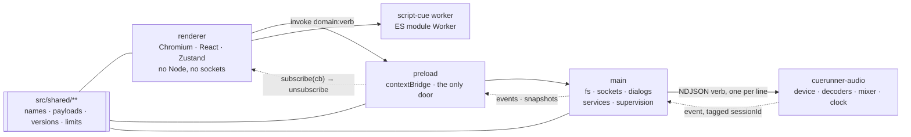
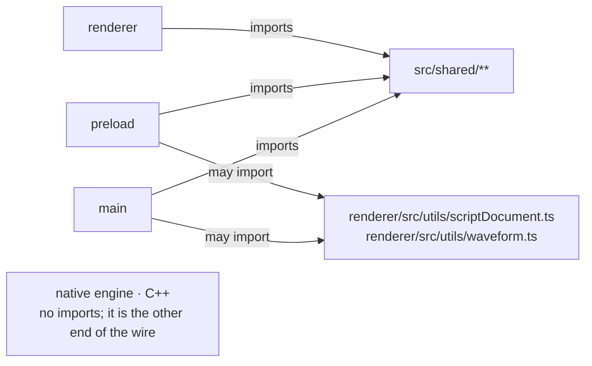
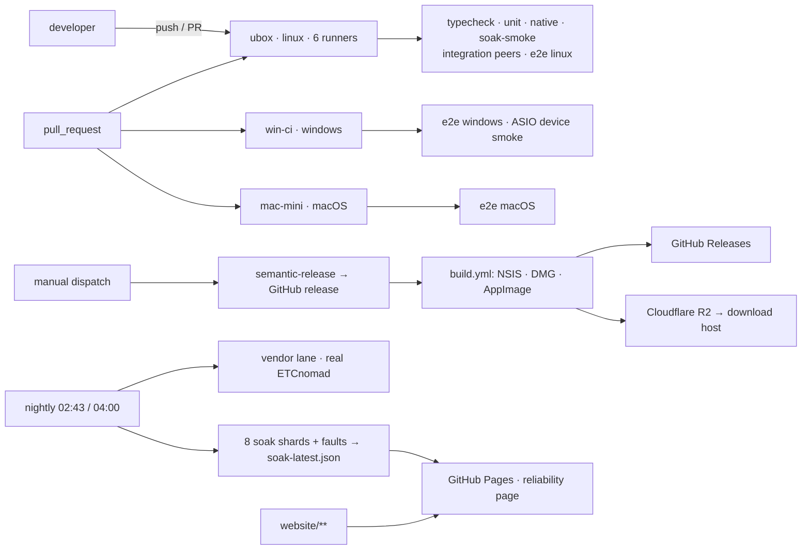
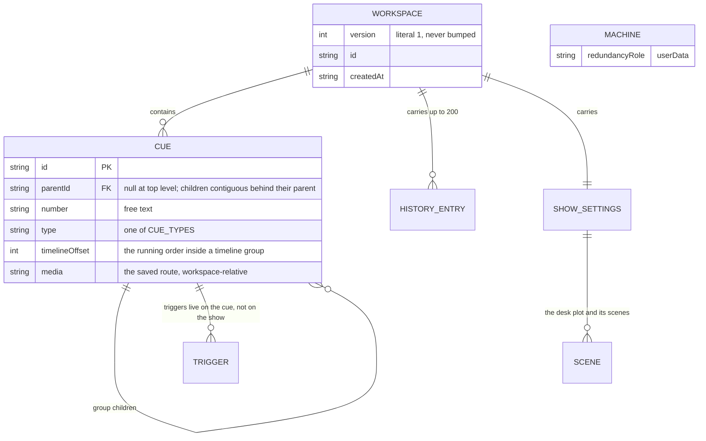

# Architecture Spine — Cuerunner

> Decisions, not rationale. Every rule below is either enforced by the code named beside it or is a rule the next builder must follow; where the two differ, the difference is recorded under Known Divergences. Read this as the consistency contract for CAP-1 … CAP-9, not as documentation of the system.

## Design Paradigm

**Supervised command–event process tree.** Four isolated runtime contexts, each owning a capability; the only way across a boundary is a versioned command–event protocol; `src/shared/**` is the single module every JavaScript context compiles against and that imports none of them — the native engine is the other end of that wire without importing it; commands travel one way and state comes back as events and snapshots.



Consequences a builder should be able to derive from it: nothing stateful lives in the renderer that outlives it; nothing that runs a show depends on a window being alive; the process that owns a resource is the only process that answers for it; and a new capability is a new service, a new verb or a new cue type — not a new cross-context shortcut.

## Invariants & Rules



Arrows point from the importer to what it may import. `src/shared/**` may be imported by every context and may import none of them. The renderer may import nothing outside itself except `src/shared/**`: `tsconfig.web.json` does not include `src/main` or `src/preload`, and its base config carries no Node types, so a Node import there fails `npm run typecheck`. Main and preload may reach upward only into the allow-list declared in `tsconfig.node.json` — those two utility modules — so every module on that list must stay free of any renderer runtime dependency. The native engine imports nothing from the tree; it is the other end of the wire.

### AD-1 — The process tree is the module system

- **Binds:** all
- **Prevents:** a fifth context or a cross-context shortcut, invented module by module, that quietly voids the crash-survival story.
- **Rule:** A unit's capability boundary is the process it runs in. The renderer touches the DOM and `window.cuerunner` and nothing else; main owns `fs`, dialogs, sockets and child processes; the native engine owns the audio device, the decoders, the mixer, the caches and the sample clock. `src/shared/**` imports nothing from `src/main`, `src/preload` or `src/renderer`. The renderer never imports `src/main` or `src/preload`. Main and preload may reach upward only into the allow-list declared in `tsconfig.node.json` — `utils/scriptDocument.ts` and `utils/waveform.ts` — so every module on that list must stay free of any renderer runtime dependency, and extending the list is a decision rather than a convenience. A new process or context is an architecture decision, not an implementation detail.
- **The renderer is trusted, and that premise is load-bearing.** Nothing untrusted is ever loaded into the window, and main holds the socket and the ledger of what a panel may do: that is what the design rests on. The isolation around it is the contextBridge, with two lines behind it — the window runs `sandbox: true`, so neither the page nor its preload has Node (the preload asks for `electron` and nothing else, which is all a sandboxed one may), and the built page carries a Content-Security-Policy as a meta tag (`src/shared/contentPolicy.ts`, written in by `electron.vite.config.ts` at build only, because the development server's hot reload is what it forbids). `contextIsolation` and `nodeIntegration` are at Electron's defaults. Neither line was designed to contain hostile content, so a change that brings remote, user-authored or otherwise untrusted content into the renderer is still a redesign of this premise, not a feature.

### AD-2 — Commands in, events out; the owner is the source of truth

- **Binds:** all
- **Prevents:** two units each holding their own answer to the same question, and a caller reading back its own request as though it were the world's state.
- **Rule:** Across every seam the caller sends a command and receives events or a snapshot; it never reads another unit's state directly. The renderer's `running` map is a projection fed from engine and show events, never a claim that overrides the engine. Device facts come from the engine's `info()`. Audible state is the engine's; panic and watchdog state is main's (`PlaybackSafety` reads `isPlaying` from the engine snapshot, never from the window). A verb that returns a value returns the owner's own answer, not a locally invented one.

### AD-3 — One declaration per IPC channel, one parity gate

- **Binds:** CAP-1 … CAP-9
- **Prevents:** a handler with no bridge entry that is silently unreachable, a bridge entry with no handler that throws on first use, and a renderer compiling against a bridge type that no longer matches the preload.
- **Rule:** Channel names and their request/response types are declared once in `src/shared`, and each end derives from that declaration rather than restating it. **Every domain is declared this way as of Story 4.1**: each has a `<DOMAIN>_CHANNELS` table, its payloads and its bridge under `src/shared/ipc/`, the preload is checked against the composed `CuerunnerBridge` by `satisfies` (as is the test suite's mock), the handlers register the declared constants, and `env.d.ts` imports the composed type rather than writing one. `AUDIO_CHANNELS`/`AudioEngineBridge` remain the worked example. **The parity gate is not built**: no test yet compares main's registered set, the preload's exposed set and the declared set, so until it lands a channel declared with no handler — or handled with no declaration — is a review question rather than a build failure. The gate the rule calls for: a parity test that fails the build when main's registered set, the preload's exposed set and the declared set disagree. Channel naming stays `domain:verb` with a camelCase verb, over the domains `app`, `playback`, `audio`, `midi`, `osc`, `network`, `show`, `redundancy`, `script`, `workspace`.

### AD-4 — Refusal discipline: three regimes, chosen by whether refusal is normal

- **Binds:** all IPC surfaces
- **Prevents:** a flood of Electron stack traces for states that are ordinary (the silent backend has no devices), and callers that cannot tell a refusal from a fault.
- **Rule:** Audio verbs return the `{ ok, value } | { ok, code, message }` envelope through `audioVerb` and never reject; the preload unwraps it with `unwrapAudioResult`, which rejects with the refusal as the plain value it is — the context bridge copies a thrown `Error` by its message and drops its `code` — and the window's engine client (`audioEngineError`, `src/renderer/src/engine/audioEngineClient.ts`) turns that value into the `AudioEngineError` callers still see, code included; `e2e/unreadable-media.spec.ts` reads the code through the real bridge. A refusal that is a normal state of the system — a cue that does not apply — is returned as a value, `{ ok: false, error }`. Only an unexpected fault rejects. A new audio verb that lets its promise reject is a bug, not a style choice.

### AD-5 — Push delivery: subscribe, then snapshot, then replay

- **Binds:** every main→renderer event stream
- **Prevents:** a window that misses the events between load and subscription, and a main process that throws when there is no window to send to.
- **Rule:** The subscriber attaches first, then takes a snapshot carrying its `at` stamp, then replays only batches newer than that stamp — as `useShowBridge` does. Every subscription returns an unsubscribe closure. Pushes go through `liveWindow`/`sendToWindow`, which skip a destroyed or crashed renderer rather than throwing: a killed renderer is a supported state, and the show keeps running through it. Payloads are batches, with audio events flushed on a 16 ms tick so one panic is one message.

### AD-6 — The audio engine owns the clock, the device and the caches

- **Binds:** CAP-1, CAP-2, CAP-3, CAP-5, CAP-9
- **Prevents:** a UI that believes it opened a 48 kHz stereo exclusive device because the workspace said so, and post-restart commands scheduled against a dead session's timeline.
- **Rule:** Every scheduling call carries an absolute `whenMs` on the engine's sample clock — never epoch, never a wall clock — and a `whenMs` in the past means now. The engine's `clock()` reply carries the session identity; the renderer's show clock is the engine clock plus a per-session epoch, and both translations live only in `audioEngineClient.ts`. Rate, buffer, channel count and exclusivity are requests: the driver (ASIO especially) owns rate and buffer, and a failed reopen restores the previous device rather than silently downgrading.
- **Every limit declares which regime it is in.** **Refuse** — unrepresentable or unsafe: a crosspoint matrix over 64, a routing request the mixer cannot hold, a schedule beyond the 10 s horizon, more pending operations than the bound allows. **Clamp and report** — the device or the caller's convenience decides, and the answer says what happened: channel count is clamped to 32 and the achieved figure comes back from `info()`, waveform points over 4096 are truncated and the reply says so, the silence threshold is bounded the same way. A new bounded parameter picks one regime and states it; "refused, never clamped" is not a blanket rule and never was.
- The engine's life is supervised by main and by nothing else: a death is counted once, restarts are bounded (three, backed off 250/1000/4000 ms), and every event carries the session it came from so a window can tell a stale session's tail from the live one. After a device loss or a latch-off, `configure` with the settings already in force is the revive lever — a no-op while the device is healthy, a reopen when it is not.
- A device the engine loses is reported as itself rather than as a generic error: the failure's panic ends every voice it lost `device-lost` — the reason the renderer's release runs on, with the engine's fault line beside it as the operator's `error`/`device` — while a voice that never sounded ends `cancelled` and every other panic (the verb, the watchdog, the menu) keeps `stopped`. Where no render thread will run again the service thread ends the stream and applies that queue itself, so the ends never wait on a thread that is gone, and the loss is raised as a show alarm in the engine's own words.

### AD-7 — No media across a boundary; the realtime thread does no work that allocates

- **Binds:** CAP-1, CAP-2, CAP-3
- **Prevents:** an IPC or wire protocol that copies audio, and a decode, allocation or file read landing on the audio callback.
- **Rule:** File paths cross boundaries; audio bytes do not. The audio thread allocates nothing, takes no lock and does no file I/O: decode, pinning, stream acquisition and path work happen on control or file threads and hand over a pinned cache entry or stream slot, which the audio thread only releases. Scheduling verbs are queued as fixed-size command pods and answered by an ack from the render thread; they never run on it. The memory bounds in `AUDIO_LIMITS` (512 MB / 100 files cached, 32 MB per-file threshold above which a file streams, 16 MB per streaming voice, 128 MB total, 10 s schedule horizon, 64 voices, 64 crosspoints, 32 output channels) are the contract, not a suggestion. **One declaration owns those bounds**: each bound's name, value and regime live once, in `AUDIO_LIMITS` (`src/shared/audio.ts`), and the engine — which cannot import that module — carries the same table as data, reads it at every enforcement site and flag default, and prints it beside the verbs for `--protocol`, with a test comparing the two so a name, value or regime edited at one end alone fails there.
- **Measurement is the engine's too**: waveform envelopes, onsets, silence detection and a file's duration are its answers, computed off the audio thread on the scan workers, because it is the only unit that has the decoded data. The renderer asks and displays; it never decodes to measure. A footprint scan over a whole workspace is headers only — nothing decoded, nothing cached, no counter touched.

### AD-8 — Each wire declares its capability set once, and refuses what it does not know

- **Binds:** CAP-2, CAP-3, CAP-6
- **Prevents:** a packaged app meeting a stale engine from an old install, a verb added without anything noticing, and a renamed or misspelled field arriving on the far side as its default instead of as an error.
- **Rule:** Each live wire — the NDJSON command protocol between main and the native engine, and the JSON-lines protocol between two redundant machines — declares **one** version constant whose meaning is *this set of verbs, events and fields*. It is declared in one place per wire, checked before the wire is first used rather than after connecting, and derived from the declaration rather than remembered. The verb set and each verb's fields are declared as data in `src/shared`; main derives what it sends from that declaration, and a test compares it against the native dispatch table. The C++ side cannot import it, so the achievable and sufficient rule is *checked against* — which is what makes a bump a computation instead of a discipline.
- **A wire refuses and reports what it does not know.** An unknown verb is an error, not a shrug; a message missing a required field is an error, not that field's default; an event type the consumer does not recognise is surfaced — logged and counted — never silently dropped in a projection. A mismatch never degrades quietly.

### AD-9 — The showfile's shape is declared; its version literal never moves

- **Binds:** CAP-7
- **Prevents:** a version bump that invalidates every existing file, and a file that loads differently depending on which code path opened it.
- **Rule:** `version: 1` is a fixed literal. `migrateWorkspace` is called by *every* path that turns bytes into a workspace — open, compare, merge, recovery, demo, bundle read — and it is a shape check, not a compatibility layer: an unknown cue type is refused rather than guessed at, a file whose shape is not this build's is refused, and no legacy pass survives. Save does not normalise; it writes what the renderer built. The same funnel owns structural normalisation (AD-12): repairing a file's grouping is part of turning bytes into a workspace, and it happens in the same place for every caller.

### AD-10 — The saved shape has one constructor and one serialiser

- **Binds:** CAP-7
- **Prevents:** a field the store holds that silently never reaches disk, a recovered or merged save missing a section the ordinary save carries, and a portable media route quietly replaced by a foreign absolute path.
- **Rule:** `buildWorkspace` is the only constructor of the saved form and `serialiseWorkspace` is the only writer. `serialiseWorkspace` names every top-level key explicitly and in a fixed order — that literal *is* the file's schema, so a field added to `Workspace` and not added there does not exist on disk. No second literal of the saved shape is written by hand.
- **The rule reaches into the cue, not just the top level.** Every cue field that reaches disk is written by that same serialiser, and the runtime's absolute `filePath` is not one of them: a cue's saved route to its media is the workspace-relative one, and a save in which the file was not found must **keep the stored route** rather than promote the machine-local path that happened to be tried. Otherwise the portable route is replaced by a foreign absolute path that no diff can see, because `filePath` is excluded from comparison by name — and the show then loads missing its media on the machine that has it.
- **The file's schema is one table, not four.** The top-level literal, `buildWorkspace`'s parameters, the sections `settingChanges` compares and the sections the merge blends are the same list seen from four sides; a section added to one and not the others is written but invisible to history and silently kept-ours by a merge. They are bound to one declaration, and adding a section means adding it there.
- The bytes are a pure function of (show, folder) for any file **this machine** writes: no clock, no absolute path that a workspace-relative one can replace, no key ordering that `stableJson` would have to forgive. The one exception is the bundle import, which carries another machine's bytes verbatim until the first ordinary save (see Conventions).

### AD-11 — Edits and measurements are distinguished per field and per cue type

- **Binds:** CAP-7, CAP-9
- **Prevents:** the app's own measurements reading as the operator's edits in history and compare, and the mirror failure of an operator-typed field being ignored because the app also writes one by that name.
- **Rule:** One place decides what counts as an edit, and it is a **predicate over (cue type, field)** — not a set of field names, because authorship is not a property of a name. It is evaluated in `fieldChanges`, which holds both cues and can therefore see the type. `soundRegion` and `parentId` are excluded for every type; `duration` is a measurement on audio cues and an operator's edit on wait and fade; `id` and `filePath` are never edits. A measurement never marks the show dirty and never enters history. Adding a derived field means teaching that predicate the rule, not adding a name to a second list — and the obvious shortcut of adding `duration` to a flat exclusion would silence genuine duration edits on wait and fade, which is the failure this rule exists to prevent.

### AD-12 — Group children are contiguous; array order is the running order

- **Binds:** CAP-1, CAP-7, CAP-9
- **Prevents:** a group drag that moves only part of its subtree while the runner still fires all of it, a new cue landing in the middle of a group, and two repairs of one file disagreeing about where a cue went.
- **Rule:** There is no sort key: the cues array is the running order, and a group's children are stored contiguously immediately behind their parent. Every writer produces that shape, a cue's group is `parentId`, and a move rewrites whole subtree blocks.
- **One normaliser owns the repair, and every load path calls it.** It lives in the migration funnel so open, compare, merge, recovery, demo and bundle read all get it for free. Its semantics are fixed, because "repaired to the top level" alone leaves a builder free to produce an observably different file: a group's children are reordered into a contiguous block immediately behind their parent; a cue whose group is missing keeps its position among the block it was in rather than being appended to the tail; and a cycle is dissolved rather than edge-guessed — every cue in the cycle returns to the top level. What it changed is reported as a **load note carried on the load result** (beside `missingMedia`), so the operator sees it and the file is not rewritten behind their back. Save still does not normalise.
- **Inside a timeline group the offsets are the running order.** `timelineOffset` is what the runner fires by and what the merge places by, so it is authoritative for those groups; the array order within one is presentation, and any writer that changes an offset keeps the array consistent with it. Two orders for one group, each honoured by a different reader, is the failure this sentence exists to prevent.

### AD-13 — History is a property of the file, and main owns it

- **Binds:** CAP-7
- **Prevents:** a window's in-memory history disagreeing with what the file says, a saved show losing the record of who changed what, and one writer destroying another's history because the rule only described the first.
- **Rule:** History lives inside the `.cuerunner` file, capped at 200 entries, because the data belongs to the show.
- **Every writer of a saved artifact is enumerated, with the base it diffs from.** A save or Save As diffs the file about to be replaced against the new contents and appends one entry on a non-empty diff — which is what keeps an unchanged save byte-identical. A merge writes to a **new** path and leaves both inputs untouched; when that path already holds this show, the destination's own history is the base and the merge is recorded as one entry, and when it holds nothing, the result must not silently claim a past it never had. A bundle import carries bytes and a history verbatim and appends nothing. The recovery snapshot is a machine file and appends nothing. Two compliant writers reaching the same path with two different histories is the failure this enumeration prevents.

### AD-14 — Machine facts and show facts live in different places

- **Binds:** CAP-6
- **Prevents:** a redundancy role saved into a showfile and read identically by both machines of a pair.
- **Rule:** Redundancy role and partner, recent files and the recovery snapshot are facts about *this machine* and live under `app.getPath('userData')`. Cues, show settings, trigger guard and history are facts about *the show* and live in the `.cuerunner` file. A machine fact is never written into a workspace, and a show fact is never written into a machine file.
- **The app's own name is part of this contract**, because Electron derives the userData folder from it, so a rename is a migration decision. The rename to Cuerunner deliberately carries no user-data migration: an install upgrading across it lands in a new folder and loses its pair role and partner, its recent files and any pending recovery. That loss is accepted and recorded, not overlooked.

### AD-15 — Retired

The free/Pro line this decision held ended when the project went MIT: every feature runs on every machine, so nothing is left to classify or gate. The number stays so that what cites it still lands here.

### AD-16 — Services are addressed by id and reconfigured by settings slice

- **Binds:** CAP-8, CAP-6, CAP-9
- **Prevents:** a single setting change dropping every listener mid-show, a service whose new port or address never takes effect, and two routes to one service disagreeing about what happened.
- **Rule:** **Four channels may address a service and no others** — `show:configure` (the set), `show:snapshot` (the record), `show:command` (one, by id) and `show:restart` (one, by id). No other IPC channel may address a service or mutate a service's state; a new `redundancy:publish`-shaped channel would skip the host's ordering — takes-no-commands, then not-running — and leave the host's status record, which is what every panel draws, describing something that no longer happened. A service can be added without a new IPC channel, and that is the point of the by-id route.
- **A reconfigure restarts only the services whose declared slice moved**, and **the slice declaration is a property of the service**, not a switch in the host: each service declares the settings sections it reads, the host enumerates that declaration, and a test asserts that everything a service actually reads is declared. A host-side switch that has to be remembered is the failure this names.
- **"Moved" means semantically moved.** Equality is `sameValue`/`stableJson`, never `JSON.stringify` and never input key order: two settings objects that say the same thing must not restart anything. That is the same reason AD-10 forbids bytes whose order a canonicaliser would have to forgive.
- **Settings application is serialised.** A configure that arrives while another is applying waits, and when it carries newer settings it is applied after rather than dropped; the "already applied" memory is committed only once every service has settled. Committing it first and applying after is how two compliant callers — the renderer's settings effect, `redundancy:configure` — leave a service running old settings that no later configure will correct, because the memory says those settings are already in force.
- Every service that binds must swallow its socket errors — an unhandled `'error'` takes main down — and unref its timers so a poller cannot hold the app open at quit.

### AD-17 — The window is not the system

- **Binds:** CAP-2, CAP-4, CAP-5, CAP-9
- **Prevents:** a show that stops because a renderer died, and a second window added as though the broadcast, the close handshake and the module-level settings state would simply work.
- **Rule:** The show runs in main and in the engine; the window is a view of it that may be killed and reloaded without dropping the show, and it must never re-fire a show that is already running on recovery. The renderer sends a heartbeat whether or not a cue is running; when the heartbeats stop while anything is playing, main's watchdog silences the engine. The app is **single-window** by design: the broadcast fan-out, the per-window close handshake and the module-level `lastShowSettings` all assume it, so multi-window is a redesign of those three, not an extra `createWindow` call. Teardown belongs in `will-quit`, never `before-quit`, because the unsaved-changes prompt can cancel the quit while the show is still meant to run.
- **Output windows are not a second control window.** The video outputs and the floating timer (AD-27) are windows main makes and owns, told apart from the control window by `isOutputWindow` (`src/main/output/OutputManager.ts`): the menu's actions, the close handshake and the settings state still belong to the one window the show is run from, a fullscreen output never takes the keyboard, and the outputs close when that window does. They are views too — killed, one reloads and is handed its pictures back by main.

### AD-18 — Build, release and CI run on the homelab, and nothing publishes on merge

- **Binds:** all
- **Prevents:** a pipeline that moves to billed runners by accident, and a release that ships because a branch merged.
- **Rule:** Every `runs-on` is a self-hosted label declared in `.github/actionlint.yaml` (linux/`ubox`, macOS/`mac-mini`, windows/`win-ci`). A per-PR lane is the truth for ordinary work; the nightly soak and the vendor lane against real ETCnomad are the truth for claims no peer can carry. Release is a manual dispatch into semantic-release, which produces a GitHub release that the packaging workflow turns into NSIS, DMG and AppImage, published to GitHub Releases and mirrored to the download host. Nothing publishes on merge. Windows and macOS signing certificates and the signed Steinberg ASIO agreement are external inputs, and their absence fails **open** — an unsigned build is green and logs a warning, and is caught by the release checklist rather than by CI.

### AD-19 — The operator environment is offline-first and installer-gated

- **Binds:** CAP-4, CAP-5
- **Prevents:** a feature that assumes the venue has internet, an update mechanism nobody decided on, and a port or device assumption that only holds on a developer's machine.
- **Rule:** No network dependency at startup, no phone-home, no cloud dependency.
- Ports and devices belong to the machine, not to the show: OSC in (53000 UDP), tablet view (53100 HTTP, read-only, token required), redundancy link (53110 TCP), desk MIDI over TCP (51325 out), discovery on 5353 — none may be assumed free, and none may be opened by the renderer. One output device, no aggregation; the driver owns rate, buffer and channels. Installers must be signed and notarised to install cleanly on a venue machine.

### AD-20 — Published numbers come from runs

- **Binds:** CAP-3, CAP-4
- **Prevents:** a claim on the site that no test holds, and a benchmark figure that drifts from the code it describes.
- **Rule:** The soak's own numbers — start delay, clock drift, xruns, decode underruns, dropped chunks, peak voices — are read from `soak-latest.json`, the nightly fan-in, and rendered by the page, which says "nothing published" when the artifact is absent. No such number is typed into prose or HTML, and a claim with no run behind it is stated as unproven where the claim would have been. The realtime multiple is a different kind of fact and is not published from an artifact at all: it is a **floor enforced by test**, where `matrix-bench` — last entry of `npm run test:native` — exits non-zero below 2× realtime, so it holds on every PR, in the release build job and nightly. Figures typed into repository prose rather than rendered from a run are outside both rules and are listed under Known Divergences.

### AD-21 — Every firing surface asks one guard and fires through one runner

- **Binds:** CAP-1, CAP-8, CAP-9
- **Prevents:** a second GO path that skips pre-wait, advance or stop semantics, and a guard that protects one surface while another sails past it.
- **Rule:** A cue can be fired four ways — the keyboard, the GO button, an OSC or MIDI trigger, and a desk button — and they all reach one place. The repeat guard is show-wide, asked before anything else, default 300 ms with 0 meaning off, and it swallows a second GO whichever surface sent it. The per-cue re-fire policy defaults to ignore, and restart is opt-in. A triggered cue is not a special case: it pre-waits, advances and stops exactly like one the operator fired by hand. A surface whose press semantics differ — a desk's own toggle *is* the press — handles that in its own adapter, never by going around the runner.

### AD-22 — A scene recall moves only what changed

- **Binds:** CAP-8
- **Prevents:** a recall that bumps or closes a channel the change did not touch, and a diff taken against a state the desk never reported.
- **Rule:** A scene cue sends the differences between the desk's state and the scene's for the channels the scene controls (AD-26), so a channel that is live and not part of the change is never bumped. The base for that diff is the desk's own reported state where the desk publishes a read; where it does not — Avantis assignments, SQ assignments today — the base is what Cuerunner last sent, and that record is held for as long as the show is open. There is no press that re-sends a scene against an emptied record: a channel's fader, mute or assignment moved by hand at the desk is not seen, and reopening the show is what forgets the record so the next recall writes every channel the scene controls. A scene cue with no scene chosen refuses and says so rather than sending an empty change set, because an empty set is indistinguishable from *close everything*. **Highest wins is the one reader of desk state:** an SQ's DCA masters report their level and mute on its MIDI service (`4F 20`–`27`, `02 00`–`07`, measured 2026-10-04), and main reads them — before the show bus batches anything for the window — to keep a channel placed on several faders on the highest of them. The window's record holds every fader the scene asked for; which one the desk holds this moment is main's (`HighestWins`), so a recall hands main such a channel whole rather than diffing its pairs.

### AD-23 — Redundancy mirrors state, never the show

- **Binds:** CAP-6
- **Prevents:** a standby that re-fires a cue the live machine is already running, a mirror that quietly turns into an editor sync, and a resume that lands in the wrong place because two units read "position" as two different things.
- **Rule:** The mirror carries the show's identity and a hash, the selected cue, how many files are warm, and the running cues with their state, position and duration — never cue bodies, never the file.
- **The mirror's numbers have units and they must be converted, not added.** A running cue's `positionMs` is a **file** position in milliseconds, because it comes from the engine's progress on the source; the silence since the partner was last heard is **wall** milliseconds on the local clock. Adoption is therefore `position + rate × silence`, folded into the loop region *as file time* — adding wall milliseconds to a file position is wrong by the rate, and inside a loop the error wraps and can land on the wrong side of the region entirely. A `prepared` count is a count of files the engine answered for: never a set, never a precondition, and a cold resume is normal and allowed.
- **A takeover requires that this machine has actually heard a partner** — a machine that never heard anyone does not seize a show — and it requires being **in sync** when the takeover is automatic. Out of sync, the automatic path stands down and says so; the operator may still take the show by hand, and the panel says what it is taking: adoption matches a running cue by id, and an out-of-sync digest may adopt cues whose identity it recognises while naming the ones it could not, because a cue re-pointed at a different file on this machine is invisible to a hash over id, number and name. Handover bumps a term and the higher term wins, with ties broken deterministically; resume adopts only audio cues that were playing, at the position above, and a cue in pre-wait or post-wait is left alone. The documented limits are part of the contract, not an apology: not an edit mirror, not a replay of one-shots, position at best a quarter-second old, and not sample-aligned.

### AD-24 — A claim is only as strong as the lane that ran

- **Binds:** CAP-2, CAP-3, CAP-4, CAP-5, CAP-8
- **Prevents:** a green weaker lane being read as proof of a stronger claim, and a lane that quietly did not run leaving its claim looking proven.
- **Rule:** Each lane carries a class of claim and nothing wider. The peers lane proves the wire format against an independently written implementation of the vendor's own documents — not desk acceptance, and not firmware equivalence. Desk acceptance is the vendor lane against real ETCnomad, on `win-ci`, and nowhere else. The Windows lane's ASIO step hosts whatever driver the machine has and exits with a note when there is none, so a missing driver means ASIO hosting is **unproven**, never proven. A claim's status is the strongest lane that actually ran; a lane that did not run leaves the claim standing exactly where it was made. Nothing may be claimed for an integration that only its own peer has exercised, and a lane that skips is reported as skipped, not as passed. A claim no lane will ever carry, because the hardware cannot sit in CI, may be **witnessed**: a person ran it on the real device and the repository holds a capture of what they saw — the device's own version, the day, who recorded it — which the unit suite replays on every run. That is stronger than a peer that only exercised itself and weaker than a lane in one way, that nothing re-runs it; the record says so in its status word, and the copy that states a witnessed claim carries no phrase that says nothing has run it.

### AD-25 — Every writer of a saved artifact is enumerated, and so is what it may do

- **Binds:** CAP-7
- **Prevents:** two writers of one artifact disagreeing about history, normalisation or the bytes themselves — the failure a rule that names only *the* save path cannot see.
- **Rule:** The write paths that produce something an operator can point at are: save and Save As, merge into a new file, bundle export, bundle import, the recovery snapshot, and the demo workspace. Each one has a declared base, a declared history behaviour and a declared normalisation behaviour, and a new writer is a row in that table before it is code.
- **`serialiseWorkspace` produces every saved byte this machine writes**, and a writer that carries bytes it did not produce says so. **`unpackBundle` is the one verbatim writer**: an imported file is the exporting machine's bytes — including that machine's absolute `originalPath` values — until the first ordinary save replaces them, so the purity claim in AD-10 holds for what this machine writes and the import is its named exception. Merge writes to a new path and leaves both inputs untouched. The recovery snapshot is a machine file and does not go through the serialiser at all.
- **Normalisation happens on the way in, never on the way out**, except where a writer is repairing what it produced: a save writes what the renderer built, while a merge repairs parents (AD-12) because it is *creating* a document rather than round-tripping one. What a load normalises is what AD-9 and AD-12 declare and nothing wider — a shape this build does not know is refused, not repaired.

### AD-26 — A scene owns the assignment, and a DCA is a control group

- **Binds:** CAP-8
- **Prevents:** a show whose per-channel fader assignment is a setup fact while the desk's membership drifts from what the scenes mean; a mute group read as a control group, so a recall silences a mic instead of placing it; and a recall that writes a channel, a patch entry or an assignment the scene never named.
- **Rule:** Assignment decides whose levels a fader controls, and it belongs to the scene: a scene carries, per DCA, the **one thing** that rides it — a channel of the console, or an ensemble over some of them — and mutes belong to the mic. An ensemble is a named set of **strips** and not of the people standing on them, because a show's cast may be nobody at all and a group has to be buildable the moment a show has strips; what it opens is what those strips open, and a strip that leaves the console leaves every group it was in. One member and not a list, because several channels on one fader is what an ensemble *is*: the shape cannot express a row that means two things, so no edit has to choose and no recall has to decide which of them wins. A row holding an ensemble opens **all** of it; there are no per-member exclusions, and an operator who wants a member off a fader builds the group that says so. A strip is a name and a picker: `ShowChannel.dcaId` does not exist, and the scene is the only thing that says which fader a channel rides. A channel may ride more than one fader unless the show turns that off; with it off, the editor keeps one fader per channel and a recall collapses any residual duplicate to the lowest-numbered DCA. With it on, a desk adds the offsets of every fader the channel rides; a show on an SQ over the network may ask instead that the **highest fader wins**, and the scene's word is kept — the channel is placed on all of them — while the desk is told only the highest (AD-22). A mic that changes fader keeps playing through the change and takes the new fader's position instantly — no mute-move-open dance. **On an SQ a recall's pairs go to the desk as one write** (and a highest-wins switch likewise): written apart, the desk sometimes applies a clear and a place on separate control ticks, leaving the channel on neither fader or on both for up to ~190 ms — measured on an SQ-6 on 2026-10-04 as a dip of the whole fader offset in 24 of 50 switches, and in none of 46 written as one.
- **What a recall may write is the controlled set and nothing else.** A controlled channel is a setup fact — a count and the desk number each channel is — the scene matrix references them by name, and the desk's I/O patch is the operator's, never modelled and never written. The channel ceiling is the active desk profile's, nothing is enforced until a profile is active, and a set larger than the desk is a gap reported the way a DCA past the profile's list is.

### AD-27 — Pictures run on outputs main owns, on the engine's clock

- **Binds:** CAP-1, CAP-2, CAP-7
- **Prevents:** a decoder on the audio thread, a picture that drifts from its own sound, a projector that goes black because the control window reloaded, and a display mapping that one machine writes into a show the next machine opens.
- **Rule:** Video, image and text cues draw on **video outputs**: windows main opens for as long as the show declares them (`Workspace.videoOutputs`), each a canvas composited every frame (WebGL 2, with a 2D fallback that draws the same plan). An output window is a context of its own with a smaller door than the control window's — a sandboxed preload, `window.cuerunnerOutput`, that reads its first state, reads the engine clock and reports what it showed, and nothing else; its channels are declared in `src/shared/ipc/outputWindow.ts` and held by `src/main/output/parity.test.ts`. It reads media only through `cuerunner-media:`, main's scheme for the files a show names, which serves video and image files by name, with byte ranges, and nothing else; the files are the operator's own media, never code, so AD-1's trust premise stands.
- **The picture is Chromium's, the sound is the engine's.** A video's picture is decoded in its output window; its sound is an ordinary engine voice under the cue's own id (`videoSound`), so routing, fades, meters, stop and panic treat it as an audio cue's. The engine reads a video container's sound track as it reads an M4A — off the audio thread, through the same decoders and the pinned helper (Matroska/WebM added) — and a container with no sound is refused `no-audio`, which the runner reads as a picture with no voice. AD-7 is unchanged: nothing of a picture reaches the engine, and nothing of the engine's audio reaches a window.
- **One clock.** Every time a picture command carries is engine milliseconds, the clock its sound is scheduled on (AD-6); an output keeps its own projection of that clock from round-trip readings and places every picture against it each frame, bending the element's rate for a small drift and seeking for a large one (`visualSync.ts`). Fades start on a picture's first presented frame and land on its own end; a crossfade's clock starts on the incoming picture's first frame and mixes the two stacks exactly (`visualComposition.ts`).
- **Main keeps the record.** Main holds every picture each output is showing and the commands since (`OutputRegistry`), so an output window that dies reloads and lands where it would have been; a panic from any surface clears every output with the sound.
- **Where an output goes is the machine's (AD-14).** The show carries what an output is — its name, its size, its timer, its corner pin and soft edges, the output it mirrors and its mask; which display it is on and whether it is fullscreen are kept in `userData/video-outputs.json` by output id, with the floating timer. A display that is missing opens the output as a window with a banner, never as a failure. A mirror is not a capture of another window: main sends it its source's commands and record, and it composes the same pictures itself at its source's size; what it does is never reported to the cues a second time.
- **A camera is an output's to open, and nobody else's.** The session grants `media` — video only — to output windows (`src/main/output/cameraAccess.ts`) and refuses it to the control window, which renders text from show files and the network. A device is named in the show by its driver's label; Chromium's id for it is salted per machine and kept in `userData/camera-devices.json` by cue id. A network stream is never fetched by the page: it reads `cuerunner-stream:`, and main fetches only from an origin a camera cue it routed names (`src/main/output/streamProtocol.ts`). A missing camera is a banner, like a missing display, and the cue keeps running. Blend modes, keyframes and a fade cue's moves are values of the engine clock like the rest of a picture's state (`visualBlend.ts`, `visualKeyframes.ts`), so a reloaded output draws them where they would have been.
- **The next GO is the picture's own list's.** A picture set to go on the next GO (`stopOnNextGo`, or the show's `pictures` default) is taken down by the next GO — button, key, trigger or desk — that fires a cue in the list the picture runs in (AD-28: its own `listId`, or its group's), over its own fade out. A GO in another list leaves it up: a list is a running order of its own, and a cart fired mid-scene must not wipe the surtitles the main list put up. A picture the GO's own crossfade is dissolving is left to the dissolve (`renderer/src/engine/stopOnNextGo.ts`).

### AD-28 — A show's cue lists are a section and a name on a top-level cue, over one array

- **Binds:** CAP-1, CAP-7, CAP-9
- **Prevents:** a GO or an advance that walks out of one list into the next one's first cue; a group split across lists by a move, a drop or a duplicate; an old show that no longer opens, or saves different bytes, because the show grew a second list; and a representation every walk of `cues` has to be taught twice.
- **Rule:** A show has one `cues` array, and AD-12 holds for it unchanged: array order is the running order and children follow their parent by `parentId`. The lists are a show-level `cueLists` section — id, name, colour, cart face, arm, clock, tile keys — and a cue **at the top level** names its list with `listId`. A child never carries one: it runs in its group's list, which is what keeps a group whole wherever it moves. The main list's id is the positional `main`, and a top-level cue with no `listId` is in it; a cue in the main list writes none, and a show with only its main list under its own name writes no section. So a show saved before lists existed is one list and saves byte-identical, and a reader that knows nothing of lists reads the main list correctly. A list's running order is the array filtered to it (`cuesOfList`); its cues need not be contiguous, and nothing may assume they are.
- **Every walk that takes "the next cue" takes it in the cue's own list.** GO, an advance, a playlist step, a takeover's handover and a remote's next and previous walk `sequenceOf(cue)`; a show of one list walks the array exactly as before. STOP is the list in front's where another list is running, and the whole show's where nothing else is; PAUSE and PANIC stay show-wide. A press fires nothing in a disarmed list. Triggers stay per cue and fire wherever the cue lives; the clock places each list's triggers at that list's offset on top of the show's, or not at all.
- **One rule settles every write.** The store's edits were written for one list; `withCueLists` wraps the store's `set` so that a cue the show already had keeps its list wherever in the tree it moves, a cue an edit makes joins the list in front, and a child names no list — for every writer, including one added later. A write that names `cueLists` (an open, an undo, a list's own edit, a move between lists) is a write about lists and is taken as it is. The selection is the list in front's playhead, so a selection that lands in another list brings that list to the front, and each list keeps its own place.
- **The funnel and the merge repair membership the way they repair grouping (AD-12):** a top-level cue naming a list the file does not have runs in the main list, a child naming a list has the name taken off, and each is a load note; the merge repairs its result the same way and keeps a cue lifted out of a deleted group in the list that group ran in. The section is read element by element and refused by name where it is not this build's shape (an id twice, no main list).

### AD-29 — A voice's jumps are read ahead: loops play from held pads, and the ring runs straight on

- **Binds:** CAP-1, CAP-2, CAP-3
- **Prevents:** silence at every wrap of a streamed vamp — the voice waiting while the decode thread flushed, repositioned and refilled its ring, uncounted — and the same wait at every skip over a 0-count slice and every seek; a devamp whose way out has to be prepared in whatever is left of the pass; a click where an operator's slice points do not meet; and a loop that is exact cached and early streamed.
- **Decision — RAM loop regions over a linear ring**, chosen over path-following read-ahead because it makes the way out of a vamp need no preparation at all: the ring is parked where the loop ends, so a devamp at any moment of a pass — its last millisecond included — is the next frame of the ring. A path-following ring would have to replace its read-ahead at the release, with only the rest of the pass to do it in.
- **One plan, two readers.** A start's path through its file — the kept slices with their counts, or the region and its loop count — is built once by `planVoice` (`native/audio/src/plan.h`), by the mixer that plays it and by the stream pool whose read-ahead follows it, so the two cannot disagree about where a slice begins.
- **Rule — the ring is linear, every jump lands in a pad.** A streamed voice's ring holds the file from where the voice is, onward, and moves only to where the voice will next read it. A *pad* is a held copy of the frames at a jump's target, decoded before the voice gets there (`stream.h`). A region that loops is held whole with the frames just past it: copied out of the ring as the ring's own decode runs through it — the very samples the first pass played — or read by a second decoder of the slot's, the pad reader, where the ring will not pass that way. From its second pass the loop plays from the pad and the ring stays parked at the loop's end. A skip's target holds a landing of `kLandingMs` (1 s); the voice lands on it while the ring moves to where it ends. A ring already linear towards that point is not left where it stands: nothing reads it while the voice plays the pad, so it lets go of the frames before the hand-over and fills on past it — parked full, it held less than a block beyond the hand-over, and the voice ran off it before the next decode pass. A seek's landing is decoded the same way on the command thread before the seek is sent (`StreamPool::prepareSeek`), and a start's first 250 ms are read into the ring before its slot is published — so a start at an offset and a Control cue's load to a later slice are jumps like the others. A target the ring already holds needs no pad. A voice reading a pad hands over to the ring where both hold the frame, crossfading the two only where a decoder's seek makes them differ.
- **Rule — no lock and no allocation on the audio thread.** Pads are allocated with their slot. The decode thread's read-ahead names, from the region the voice publishes, the loop it is in and the next two jumps after it, and keeps one pad free for a seek; a filler claims a pad under the slot's pad lock, which the audio thread never takes. Only the audio thread gives a pad back (Ready → Retired), once it is not reading it; a seek's pad is pinned until the seek is applied. The ring's reposition handshake clears its request only once the window is the new one, so the audio thread never reads or releases a window that is moving.
- **Rule — the budget is the declared one.** Pads come out of `streamMaxBytesPerVoice` beside the ring (four pads, each the longest loop plus its tail or a landing, whichever is longer, and no more than an even share of what the ring leaves) and out of `streamMaxTotalBytes` — clamp and report: pads shrink, then go, before a ring is refused, and a voice's `streamBytes` is its ring and pads together. **A loop longer than a pad** plays a pad's worth from the pad each pass and the rest from the ring, which is sent back to the pad's end at each wrap: that reposition has the pad's length to happen in, and the way out is still the ring running on.
- **Rule — joins.** A jump whose landing sample is within `kCleanJoinStep` (2⁻¹⁰, −60 dBFS) of where the waveform was going is made sample for sample. Otherwise the material the voice leaves plays on under the material it lands on over an equal-power crossfade of `kJoinCrossfadeMs` — **3 ms, an engine constant, the same for every show** — and the landing begins on its own frame, so every pass and every slice still starts on its sample and a devamp's timing is what it was. A loop shorter than two crossfades gets one half its length. Past the end of the file, where there is nothing to go on to, the next sample is predicted from the last two and the last one is held under the crossfade.
- **Rule — what cannot be read is counted.** A frame a streamed voice cannot read is an underrun in `decodeUnderruns`, whatever the reason — a disk that could not keep up, or a jump the read-ahead did not reach in time, whose ring is then sent there. There is no uncounted waiting.
- **Rule — a decoder's seek lands on the sample.** The read-ahead assumes it: dr_mp3's seek, which counted an encoder delay into its position and landed every seek on a used decoder that many frames early, is read back with the delay taken off; the Linux ffmpeg helper seeks to 200 ms before the target and trims after the input, which lands AAC on the sample past its decoder's warm-up. **Known limit:** through that helper a WebM/Opus seek still lands a millisecond early, because Matroska keeps its times in milliseconds — so in a video's sound, a skip past the ring or a seek plays that file a millisecond early from the landing; its loops, copied from the ring, do not. `native/audio/tests/seamless.mjs` holds all of this to a reference decode of the same file, in every format the engine reads.

## Consistency Conventions

| Concern | Convention |
| --- | --- |
| IPC channels | `domain:verb`, camelCase verb; declared once in `src/shared`; the audio namespace is the worked example; only `show:*` may address a service |
| Cue ids | `crypto.randomUUID()` for cues and for operator-added setup rows; positional (`dca-N`, `channel-N`) for default setup so two copies of one show stay byte-identical |
| Cue numbering | `number` is free text, not a position: inserting never renumbers; it is not asserted unique |
| Cue types | `CUE_TYPES` in `src/shared/cue.ts` is the one list. Anything that must cover all twelve — the icon set, a menu, a migration's unknown-type refusal, a test — reads it from there rather than repeating it |
| Placement | A cue's place is `parentId` plus its position in the array; inside a timeline group the position is its `timelineOffset`. The diff's "moved" is a *report* — the smallest set that explains a reordering — and is not the merge's input; those are per-parent sequences |
| Cue lists | A list is `cueLists[i]` plus the top-level cues whose `listId` names it (none names `main`); its running order is the array filtered to it. The next cue is always the next in the cue's own list (AD-28) |
| Time | milliseconds everywhere; absolute on the engine's sample clock for anything scheduled; never epoch, never a wall clock |
| Units | `volume` 0–1; `pan` −1…1; crosspoint channels zero-based; MIDI channels 1–16; `loopCount` 0 = once, −1 = forever; MSC `deviceId` 0–126 with 127 all-call |
| Mirror units | A mirrored position is **file** milliseconds; the silence since the last beat is **wall** milliseconds and is converted through the cue's rate before either is added or folded; `prepared` is a count of warm files, never a precondition |
| Settings equality | `sameValue`/`stableJson` — never `JSON.stringify`, never input key order; two settings that say the same thing must not restart a service |
| Refusals | `{ ok: false, error }` as a value; audio verbs use the `AudioResult` envelope and never reject |
| File formats | `.cuerunner` — JSON, 2-space, explicit fixed key order, deterministic bytes. `.cuerunnerx` — zip, entries sorted by name, fixed 2001-01-01 timestamps, `show.cuerunner` + `media/<name>`, media deduped per real file with unique suffixed names |
| Bundle limits | The 64-bit zip extension is **not written**: the bundle is a classic zip with a ~4 GB media ceiling, refused rather than half-supported. Import checks entry sizes and CRCs before unpacking, caps the show entry's size before parsing it, and refuses to overwrite existing files unless told |
| Saved-artifact writers | The enumeration is **declared in code**: `src/main/workspace/writers.ts` states each writer's base, history behaviour and normalisation as data, and `writers.test.ts` drives each row's entry, so a writer added or changed is held there. This row does not repeat the claims — a second copy is what AD-25 exists to prevent, and this one had drifted from the code — it names where they live. |
| Storage split | machine facts in `userData`; show facts in the workspace |
| Logging | main → `reportMainError` with a 20-entry backlog plus `app:main-error`; renderer failures into the session log, bounded at 500 lines with repeats collapsed |
| Devices | `deskLinkName(host, port)` is the one spelling of a device identity — the service's device id, a trigger's device and the renderer's reader all use it. Discovery browses the vendor's own mDNS names, `_netaudio-arc._udp.local` and `_netaudio-cmc._udp.local`; they belong to the firmware on the other end, so neither half can rename them |
| Visual language | The `:root` tokens in `App.css` are the authority and are not a matter of taste: four text tones all clearing 4.5:1 on every surface they can sit on (`--fg-disabled` is deliberately below and is for disabled controls only), no fifth grey, one `.field-row` grid with one label width and one control height, hints that fit on one line, and type icons drawn in `utils/cueIcons.tsx` rather than typed. `scripts/theme.test.ts` and `e2e/legibility.spec.ts` hold it |
| Run controls | GO is the only saturated press and PANIC has no transport button by design — a press beside GO must not be able to become one; the ways in are ⇧Esc, the Playback menu, OSC `/cuerunner/panic` and MIDI All Sound Off |
| Docs | an operator-visible change updates `website/docs/guides.mjs` or `website/docs/reference.mjs` in the same commit; both are generated by `node website/build-docs.mjs` |
| Tests | each fix lands with the test that keeps it true; E2E drives real Electron windows on the runners; an integration assertion reads the counterpart's own record, never the app's self-report; a lane that skips reports as skipped, never as passed |

## Stack

SEED — true as built at v0.13.0; the code owns this once it exists.

| Name | Version |
| --- | --- |
| Electron | 41.5.0 |
| electron-vite / Vite | 5.0.0 / 7.3.6 |
| electron-builder | 26.8.1 |
| TypeScript | 6.0.3 |
| React / React DOM | 19.2.5 |
| Zustand | 5.0.12 |
| Vitest | 4.1.10 |
| Playwright | 1.59.1 |
| node-osc | 11.4.0 |
| midi (RtMidi, optional dependency) | 2.0.0 |
| Node | 24 in CI (a 24/26 matrix on a few lanes); `engines.node` declares the floor |
| Native engine | C++17, no build system — `scripts/build-native-audio.mjs` drives MSVC / g++ / clang++ |
| miniaudio | 0.11.25 (`MA_NO_DECODING`) |
| dr_libs, stb_vorbis, cJSON | pinned by commit + sha256; cJSON 1.7.18 |
| FFmpeg (Linux decoder helper) | 8.1.2, LGPL-only, sha256 + PGP verified, never committed |
| ASIO SDK | deliberately unpinned and never committed; `CUERUNNER_ASIO_SDK` resolves it, a signed agreement gates shipping a linking build |
| Supported platforms | Windows 10+ (primary), macOS 12+ as `build.mac.minimumSystemVersion` (the floor Electron 41 imposes), 64-bit Linux AppImage (experimental) |

## Structural Seed

```text
src/
  shared/      # the seam: cue/showfile/audio/redundancy payloads, versions, limits
  main/        # fs, sockets, dialogs, services, engine supervision
    audio/     #   AudioEngine — spawns and speaks to cuerunner-audio
    bus/       #   ShowBus + ServiceHost — the service contract
    ipc/       #   handlers.ts — every ipcMain.handle; broadcast.ts — liveWindow
    services/  #   the eight services; ports and protocols live here
    show/      #   defaultServices() and the runtime that owns them
    workspace/ #   the sole file writer, migrations, history, merge, bundle, recovery
  preload/     # contextBridge — the only door into the renderer
  renderer/src/
    types/     # the data model; imported by main and preload through the tsconfig allow-list
    store/     # one Zustand store — cues, show setup, undo, session log
    engine/    # CueEngine (sequencing), audioEngineClient (the clock seam), workers
    hooks/     # one adapter per boundary: useShowBridge, usePlaybackBridge, useCueTriggers, useRedundancy, useWorkspace
    utils/     # pure helpers and the drawn cue icons; no store, no IPC
    components/ # drawing and local interaction only
  test/        # vitest setup and the bridge mock
native/audio/  # the engine: src/, third_party/, tests/
integration/   # peers, fixtures and the specs that hold them to the vendor documents
e2e/           # Playwright against real Electron windows
scripts/       # build, native, e2e and soak tooling
website/       # generated docs and the reliability page
```





## Capability → Architecture Map

| Capability | Lives in | Governed by |
| --- | --- | --- |
| CAP-1 cue stack | `renderer/src/store`, `renderer/src/engine/CueEngine`, `shared/audio` verbs; the picture cues in `renderer/src/engine/visualCues`, `renderer/src/output` and `main/output`; `shared/cueLists` | AD-2, AD-3, AD-6, AD-12, AD-21, AD-27, AD-28 |
| CAP-2 sound survives the interface | `main/audio/AudioEngine`, `main/safety`, `native/audio` | AD-1, AD-6, AD-7, AD-17, AD-24, AD-29 |
| CAP-3 stated tolerances | `native/audio` mixer, clock and stream pool; `native/audio/tests/soak.mjs`, `seamless.mjs` | AD-6, AD-7, AD-20, AD-24, AD-29 |
| CAP-4 supported platforms | `package.json` build config, three packaging lanes, `scripts/ensure-native.mjs` | AD-1, AD-18, AD-19 |
| CAP-5 Windows pro audio | `native/audio/src/asio_backend.cpp`, `scripts/asio-sdk.mjs` | AD-6, AD-7, AD-8, AD-18, AD-19 |
| CAP-6 redundant playback | `main/services/RedundancyService`, `shared/redundancy`, `hooks/useRedundancy` | AD-8, AD-14, AD-16, AD-17, AD-23 |
| CAP-7 showfile as artifact | `shared/showfile`, `shared/showfileMerge`, `main/workspace` | AD-9, AD-10, AD-11, AD-12, AD-13, AD-25, AD-28 |
| CAP-8 desk integration | `main/services/*`, `main/midi`, `renderer/src/utils/desk*`, `integration/` | AD-4, AD-16, AD-22, AD-24, AD-26 |
| CAP-9 run-of-show ergonomics | `renderer/src/components`, `renderer/src/store`, `renderer/src/engine` | AD-3, AD-5, AD-11, AD-12, AD-21, AD-28 |

## Non-goals (fixed)

Refusals the architecture carries, not preferences. Each is tied to the rule it protects: a proposal that lands one of these is a decision to reopen, never an addition to make.

| Not this | Because |
| --- | --- |
| ~~No video, image or projection cues~~ **Reopened 2026-10-08** by the operator's commission: video, image and text cues on video outputs, under AD-27, with the decoder in the output window and only the sound on the engine. Media-server territory beyond that — show-wide mapping, live camera inputs, a timeline of its own — is still driven over network, OSC or MIDI | AD-27 keeps the picture's decode out of the realtime path (AD-7), and the output window is a context declared as one (AD-1) |
| No plugin hosting (VST), no cloud features, no phone-home | AD-19: the venue machine is offline-first and the app is not a client of anything |
| Not a lighting console: DMX goes out of this machine as interop — a patch, faders, Light cues with tracking — and the lighting job past that stays with the consoles and QLC+ | Art-Net/sACN arrived under AD-16 as the `dmx` service, addressed by `show:command` and reconfigured without a restart; the lighting state lives in main beside the sockets (AD-17), and nothing about a console's programming surface is taken on |
| No audio-device aggregation: one output device, and clocking belongs to the OS aggregate or Dante/AES67 | AD-19: the driver owns rate, buffer and channels |
| No OSC wildcard or pattern matching; OSC input is UDP only | AD-21: a trigger fires exactly as GO does, which a pattern cannot promise |
| The tablet view is read-only by design, with no write route in either half | AD-16: the content is published into main, and nothing reads back out |
| No concurrent editing of one showfile; merge is for the two files that result | AD-12, AD-13 and AD-25: the file has one writer and history is diffed against the file on disk |
| Not distributed through app stores | AD-18 and AD-19: installers, signing certificates and the download host are the channel |

## Known Divergences

Findings with evidence, carried here so a builder meets them deliberately. None of these is a rule; each names the AD it falls under.

| Finding | Evidence | Under |
| --- | --- | --- |
| The repository's agent-context file (`CLAUDE.md`) was deleted on 2026-09-17: its Architecture and Playback-engine sections described a Web Audio `AudioPlayer.ts` and a `cueRunner` singleton that no longer exist (no `AudioContext` remains in `src/`). The live half — CI topology, design tokens, test discipline — moved to the workflows' own comments, this spine's conventions, and the spec. | the file at `4a938ac`; `src/renderer/src/engine/audioEngineClient.ts` | AD-1 |
| ~~The renderer runs `sandbox: false` by hand, and no Content-Security-Policy exists anywhere — no header, no meta tag. AD-1's trust premise is what makes that tolerable, and it is stated for the first time in this spine.~~ **Closed**: the window runs `sandbox: true` and the built page carries a policy (`default-src 'self'`, no inline script, no eval); `e2e/content-policy.spec.ts` holds both in the real app. The trust premise stands as written — these are behind it, not instead of it. | `src/main/index.ts`; `src/shared/contentPolicy.ts`; `electron.vite.config.ts` | AD-1 |
| ~~No parity test exists in any suite, so a channel declared with no handler — or handled with no declaration — passes the build.~~ **Closed in Story 4.2**: `src/main/ipc/parity.test.ts` registers the real entry points against a mocked `ipcMain` and fails in both directions — `unhandled: []` and `notAnInvoke: []` — beside `withoutHandler`/`withoutCaller` over the bridge's own calls and `misaddressed`, which holds a member to its own table key. | `src/main/ipc/parity.test.ts` | AD-3 |
| The saved shape is written by three hand-written literals — `buildWorkspace`, an inline object in `RecoveryNotice.tsx`, and `blankWorkspace` — of which the last has no callers; and the file's schema lives in four separate lists (the serialiser literal, `buildWorkspace`'s parameters, `settingChanges`' sections, `mergeSettings`' sections) where the spine names one. | `renderer/src/utils/workspace.ts`, `components/.../RecoveryNotice.tsx`, `main/workspace/WorkspaceManager.ts:543-590`, `shared/showfile.ts:286-295`, `shared/showfileMerge.ts:272-275` | AD-10 |
| No load path repairs grouping: `migrateWorkspace` converts legacy `childIds` only, `loadWorkspace` stores the array as-is, `useParentGroup` returns null for a missing parent, and no cycle detection exists — the repair and its note live only in merge. An orphaned cue never fires with its show, and a cycle recurses without bound. | `main/workspace/WorkspaceManager.ts:327-371`; `store/index.ts:1323-1345,1558-1564`; `shared/showfileMerge.ts:476-491` | AD-12 |
| The audio protocol version exists as four literals — `shared/audio.ts:24`, `native/audio/src/engine.h:144`, `engine.cpp:1204`, `main.cpp:159` — with the comparison made only after connecting, so adding a verb bumps nothing. | `src/shared/audio.ts:24`; `native/audio/src/engine.h`, `engine.cpp`, `main.cpp`; `main/audio/AudioEngine.ts:429` is the comparison site | AD-8 |
| A new engine event type, or a new field on `state`, is silently swallowed: `normalizeEvent` maps the known types and returns `null` for everything else, and the null is discarded. The event half of the wire has no unknown-detection at all. | `src/main/audio/AudioEngine.ts:560-600` | AD-8 |
| `useWorkspace`'s dirty witness is `cues` identity, `past.length` and the name, so an edit to the trigger guard, audio settings, MIDI settings or the rf/presence/script/companion sections races a save invisibly. Widening the witness is a strengthening: the rule against weakening product behaviour to green a test does not protect this. | `renderer/src/hooks/useWorkspace.ts:60-66` | AD-11 |
| The two renderer save flows hand-implement the in-flight witness and the recovery notice's save does not, so an edit landing while that write is in flight is neither written nor reported; the recovery snapshot also bypasses the serialiser, and no save checks whether the file moved under it. | `renderer/src/hooks/useWorkspace.ts:26-49,307-322`; `components/.../RecoveryNotice.tsx:50-99`; `main/workspace/recovery.ts:30-41` | AD-25 |
| `blankWorkspace` is dead code; `electron-store` is a declared runtime dependency with no import in `src/`. | `main/workspace/WorkspaceManager.ts`, `package.json` | AD-10 |

## Deferred

| Not decided here | Why it can wait |
| --- | --- |
| ~~The parity gate for the IPC domains~~ | **Done in Story 4.2** — the gate is `src/main/ipc/parity.test.ts`, so it is no longer a thing waiting on a decision. |
| Auto-update channel | Distribution is installers plus GitHub Releases today; SPEC carries it as an open question and no architectural constraint depends on the answer |
| Linux's tier: supported or experimental | SPEC open question; the AppImage lane and its build-time ALSA requirement are already true either way. The macOS floor moved for the same class of reason and is recorded above rather than deferred |
| LTC/MTC timecode, Art-Net/sACN, Shure receiver integration, cue print, QLab import — and whether they are commitments | Wave 3, unbuilt; each arrives as a new cue type or a new service under AD-16 |
| The hardware lane, the A&H vendor job, and any end-to-end MSC lane | Integration-harness gaps, named in SPEC's open questions. MSC has no end-to-end lane today, so what may be claimed for it is narrower than for Eos or the desk link — that changes what is proven, not what the architecture is |
| ~~Migrating `src/renderer/src/types/**` into `src/shared` so the upward import disappears~~ | **Closed in Story 4.1**: the seven type modules live in `src/shared/`, every importer was re-pathed, and the allow-list carries only the two utility modules it always also held |
| Which audio backend a future platform gets, and any per-backend clamping beyond what miniaudio reports | AD-6 fixes the two regimes and who owns the answer; the specific per-backend behaviour is unverified and belongs to whoever adds the backend |
| The Wave 3 remote-command item | Unbuilt: it is not the `companion` service, which is a different thing sharing a name, and it is not the read-only tablet view. The naming collision is worth resolving when it lands |
